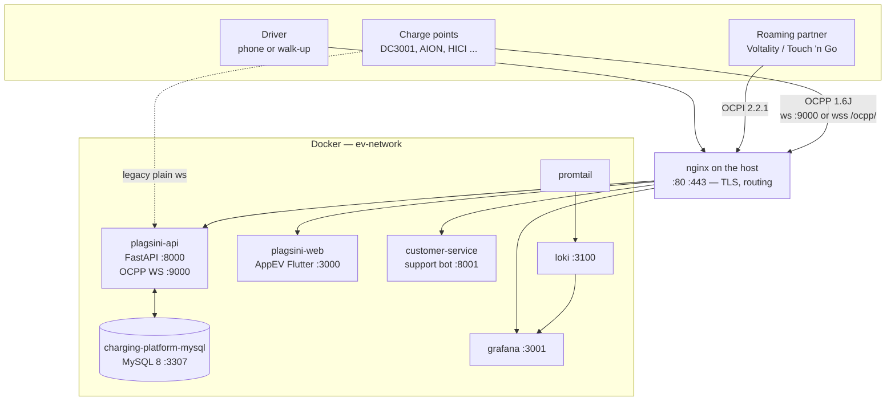

# 01 — Architecture

Everything runs on **one VPS**: `203.99.148.43`, Ubuntu, nginx on the host,
everything else in Docker. There is no second server, no staging box, and
no cloud load balancer. That is worth knowing before you plan anything: if
this machine is down, every product below is down.

## The whole picture



The dotted line matters: some chargers still connect straight to port 9000
instead of through nginx. See "Ports" below.

## What each piece is

| Container | Image | Port | What it does |
|---|---|---|---|
| `plagsini-api` | built from `ChargingPlatform/` | 8000, 9000 | **The whole platform.** Dashboard, REST API, OCPI roaming, and the OCPP WebSocket server for chargers |
| `plagsini-web` | built from `AppEV/` | 3000 | The Flutter driver app, served as web at `/app/` |
| `customer-service` | built from `CustomerService/` | 8001 | Support chatbot |
| `charging-platform-mysql` | mysql:8.0 | 3307 → 3306 | Every table. 37 of them |
| `grafana` | grafana 11.4 | 3001 | Dashboards and alerts, at `/monitoring/` |
| `loki` + `promtail` | grafana 3.5.5 | 3100 | Log aggregation. Promtail tails the container logs into Loki |
| `plagsini-certbot` | certbot | — | Renews the TLS certificates |
| `docker-socket-proxy` | tecnativa | — | Lets promtail read container metadata without handing it the raw Docker socket |

**Other products share this machine.** They are separate compose projects
and not part of the CSMS, but they compete for the same CPU and disk:

| Product | Port | Domain |
|---|---|---|
| HICOM PWA | 3200 | hicom.plagsini.com |
| PlagSini Mini | 3300 | home.plagsini.com, mini.plagsini.com |
| Proton Home Charge | 3400 | proton.plagsini.com |
| C-Zero Car Reservation | 5000 | reservation.c-zero.com.my |

Each has its own Postgres or MariaDB container plus a backup sidecar. If
you are hunting disk usage, look there first.

## How a request is routed

nginx on the host owns ports 80 and 443 and matches on `server_name`.
Config lives in `/etc/nginx/sites-enabled/`.

**`charger.czeros.tech`** (`default`) is the CSMS:

| Path | Goes to | Notes |
|---|---|---|
| `/` | `:8000` | Dashboard and API |
| `/ocpp/` | `:9000` | Charger WebSockets over TLS |
| `/app/` | `:3000` | The Flutter driver app |
| `/bot/`, `/api/bot/` | `:8001` | Support chatbot |
| `/monitoring/` | `:3001` | Grafana |
| `/api/partner/` | `:8000` | Rate-limited separately |
| `/api/(auth\|login\|register\|verify\|otp)` | `:8000` | Rate-limited separately |
| `/static/firmware/` | `:8000` | Served over **plain HTTP too**, deliberately |

The other four domains are simple reverse proxies to the ports in the table
above.

## Ports, and which are exposed

```
PUBLIC (0.0.0.0)                 LOCALHOST ONLY (127.0.0.1)
  80, 443   nginx                  3000  AppEV      3307  MySQL
  8000      API, direct            3001  Grafana    5432  hicom-db
  9000      OCPP, plain ws         3100  Loki       5433  mini-db
                                   8001  Bot        5434  proton-db
                                   3200  hicom      5000  carbooking
                                   3300  mini
                                   3400  proton
```

**Port 8000 is open to the internet on purpose and must stay that way.**
Some charge points can only fetch firmware over plain HTTP; they cannot do
TLS. Closing 8000 breaks firmware updates on that hardware. This is a known
trade-off, not an oversight.

**Port 9000 is plain WebSocket, also on purpose.** Chargers that cannot do
TLS connect here. Chargers that can should use `wss://charger.czeros.tech/ocpp/`.

## The application, inside `plagsini-api`

One Python process runs two servers (`ChargingPlatform/main.py`):

- **FastAPI on 8000** — every HTTP thing
- **OCPP WebSocket on 9000** — every charger

Plus background tasks: the orphan-session watchdog, the OCPP state healer,
and the scheduled-charging worker.

### Modules worth knowing

| File | Lines | What it is |
|---|---|---|
| `api.py` | 11,500 | Every HTTP endpoint and every dashboard page. It is big. Search, don't read |
| `ocpp_server.py` | 2,700 | OCPP 1.6J. Where chargers are actually handled |
| `ocpp_server_v201.py` | 1,300 | OCPP 2.0.1, for the few chargers that speak it |
| `database.py` | 1,400 | **The schema.** All 37 models, plus the mapper events that enforce invariants |
| `payment_gateway.py` | 1,100 | Payment providers |
| `ocpi/` | — | Roaming. Locations, Sessions, CDRs, Tariffs, Commands |
| `idle_billing.py` | 420 | The fee for leaving a car plugged in after it has finished |
| `invoice_export.py` | 620 | The CSV, Excel and PDF a finance team receives |
| `vendor_portal.py` | 850 | `/vendor`, scoped logins for charger manufacturers |
| `security.py` | — | JWT, password hashing, staff sessions |
| `templates/` | 22 pages | The dashboard. Plain HTML and vanilla JS, no build step |

There is no frontend framework and no bundler for the dashboard. A template
change is live the moment the container restarts. That is deliberate: it
keeps the operator UI editable by anyone who can read HTML.

### The data model, in one breath

```
tenants ──< chargers ──< charging_sessions ──< meter_values
                │              │
                │              └── ocpi_partner_id ──> ocpi_partners
                ├──< faults
                ├──< charger_connection_events   (keyed by charge_point_id, not id)
                └──< pricing, schedules, bookings, reviews, maintenance_records

users ──< wallets, payment_transactions, support_tickets
```

Two things in `charging_sessions` exist so history cannot be rewritten:

- `tariff_per_kwh_at_start` and the idle-fee columns beside it — the prices
  the session was sold at, frozen when it started
- `tenant_at_start` — the fleet it belonged to, frozen the same way

Change a charger's price or move it between fleets and every past session
keeps its own figures. This is load-bearing: invoices already sent must
reproduce exactly. See [05 — What will bite you](05-gotchas.md).

## Where the money comes from

Three ways a charge gets paid for, and they are not the same population:

1. **App or walk-up** — the driver pays us directly, through the wallet or
   a payment gateway.
2. **Roaming** — a partner (Voltality, who front Touch 'n Go) sends their
   customer. We bill the *partner*, monthly, through OCPI. They bill their
   customer.
3. **Fleet** — chargers tagged to a tenant like Perodua or HICOM, reported
   per fleet for internal P&L.

Confusing (2) and (3) is the most expensive mistake available on this
platform. The invoice page says which is which every time you open it.
