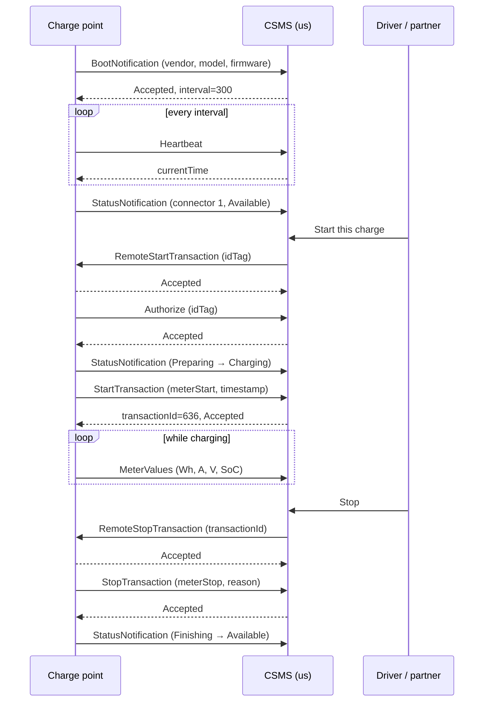

# 02 — How OCPP works

OCPP is the language charge points speak to a central system. We implement
**OCPP 1.6J** (`ocpp_server.py`) and, for a few chargers, **2.0.1**
(`ocpp_server_v201.py`). Nearly everything in the field is 1.6J.

If you read nothing else: **the charger is in charge.** It opens the
connection, it decides when to tell us things, and it can ignore what we
ask. Our server reacts; it does not drive.

## The shape of it

A persistent WebSocket, opened by the charger, carrying JSON in both
directions. Every message is an array:

```
[2, "<unique-id>", "<Action>", {payload}]    Call      — a request
[3, "<unique-id>", {payload}]                CallResult — the answer
[4, "<unique-id>", "<code>", "<desc>", {}]   CallError  — it went wrong
```

Both sides can send a Call. The charger sends BootNotification, Heartbeat,
StatusNotification, MeterValues. We send RemoteStartTransaction,
RemoteStopTransaction, Reset, GetConfiguration and so on.

## How a charger connects to us

```
wss://charger.czeros.tech/ocpp/<CHARGE_POINT_ID>?token=<token>   preferred
ws://203.99.148.43:9000/<CHARGE_POINT_ID>?token=<token>          legacy
```

The last path segment is the charge point id. The WebSocket subprotocol is
`ocpp1.6`.

Authentication is a **token in the query string**, controlled by env vars
on the container:

- `OCPP_REQUIRE_AUTH=1` (default) — a token is required
- `OCPP_SHARED_TOKEN` — one token for every charger
- `OCPP_CHARGER_TOKENS=CP1:t1,CP2:t2` — a token per charger

Not every charger supports a query string, which is why `auth_method` is a
column on `chargers` and shows as "query-string" or "none sent" in the
dashboard.

> **Known weakness.** A charger that connects and sends BootNotification is
> created in the database automatically, with no human approval. An internet
> scanner that finds port 9000 can therefore create a charger row. The
> mitigation is that a new charger is created **hidden** (`is_public=False`),
> so it is never published to a roaming partner. You will see debris like
> `PROBE31972600` in the list. It is harmless, and deletable.

## A charge, start to finish



**The gap that costs money is between StopTransaction and the cable coming
out.** The car has stopped drawing power but the bay is still occupied. We
bill for it (`idle_billing.py`), and the session is not final until the
unplug. The dashboard shows that state as **IDLING**, not COMPLETED.

## The messages we handle

From `ocpp_server.py`:

| Message | What we do with it |
|---|---|
| `BootNotification` | Create or update the charger row. Vendor, model, firmware. Answer with the heartbeat interval |
| `Heartbeat` | Stamp `last_heartbeat`. This is what "online" means |
| `StatusNotification` | Per-connector state: Available, Preparing, Charging, SuspendedEV, Finishing, Faulted. Faults are recorded |
| `Authorize` | Is this idTag allowed to charge? See the trap below |
| `StartTransaction` | Open a `charging_sessions` row, assign the transaction id |
| `MeterValues` | Energy, current, voltage, and State of Charge if the car reports it |
| `StopTransaction` | Close the session, record the reason, decide who stopped it |
| `FirmwareStatusNotification` | Progress of a firmware update |
| `DiagnosticsStatusNotification` | Progress of a diagnostics upload |
| `DataTransfer` | Vendor-specific extras |

### The Authorize trap, and why it matters

A charger that accepts our RemoteStartTransaction will often then ask
"is this idTag valid?" before it starts. On 25 November this broke every
partner-initiated charge: `on_authorize` only knew our own app tags, so a
roaming partner's token was answered **Blocked** three seconds after we
had handed it to the charger. The partner was told ACCEPTED, because the
*command* had been accepted, and the car never charged.

`ocpp_server.py` now remembers a tag it hands a charger for 180 seconds
(`_remember_remote_start` / `_is_our_remote_start`). If we gave the charger
the tag, we authorise it.

**The lesson to carry:** when a partner says a command "did nothing", read
the OCPP exchange *after* our RemoteStart, not just the OCPI reply. A
command being ACCEPTED means only that the charger took the instruction.

### Who stopped the charge

OCPP 1.6 gives a reason on StopTransaction, but DC3001 answers `Other`
both when the driver ends it from the car's own screen and when it finishes
by itself. The reason alone cannot say who did it.

So `charging_sessions.stop_initiator` records **platform**, **charger** or
**vehicle**, decided at StopTransaction by `ocpp_server.stop_initiator()`,
which knows whether we sent a RemoteStop. `stop_reason` keeps the charger's
own word beside it.

## What we can ask a charger to do

Through the dashboard at `/operations`, or the API:

| Call | Used for |
|---|---|
| `RemoteStartTransaction` | Start a charge for an idTag |
| `RemoteStopTransaction` | Stop one by transaction id |
| `GetConfiguration` / `ChangeConfiguration` | Read and write the charger's own settings |
| `Reset` (Soft / Hard) | Reboot it |
| `UnlockConnector` | Release a stuck cable |
| `TriggerMessage` | Ask it to send a StatusNotification, MeterValues etc. now |
| `UpdateFirmware` | Point it at a firmware URL to fetch |

All of them can be rejected by the charger, and some chargers lie about
accepting. Always confirm with the resulting StatusNotification.

## OCPP 2.0.1, briefly

Different enough to catch you out:

- A charger has **EVSEs**, each with **connectors**. In 1.6 there are only
  connectors.
- **The "gun number" an operator means is the `evse_id`, not the
  `connector_id`.** On a two-gun 2.0.1 charger both guns are
  `connector_id=1` under `evse_id` 1 and 2. Getting this wrong starts the
  wrong gun.
- The charger mints the transaction id, and it is a **string** up to 36
  characters. Our `transaction_id` column is an integer that everything
  bills on, so 2.0.1 sessions get a generated integer and keep the real
  one in `ocpp_transaction_id`.
- `TransactionEvent` replaces Start/Stop/MeterValues as one message.

## Debugging a charger

```bash
# Is it connected right now?
ssh plagsini 'sudo docker logs plagsini-api --since 10m | grep <CP_ID>'

# Every connect, disconnect and boot, with close codes — in the dashboard:
#   Chargers → ... → Connectivity log
```

`ocpp_message_log` holds the raw frames, and `charger_connection_events`
holds one row per connect, disconnect or boot with the WebSocket close
code. Close code **1006** means the link dropped without a proper close:
usually a weak SIM signal, not a bug in our code. `DG322021572` has done
this every two minutes for months.

Grafana at `/monitoring/` graphs this. Loki keeps 30 days.

## Chargers in the field

| Vendor | Model | OCPP | Notes |
|---|---|---|---|
| Gresgying | 30kW DC (`DC3001`) | 1.6J | The main test and demo unit, Shah Alam office. Published to roaming |
| AION | E7-A | 1.6J | Several. Large OCPP frames die over TLS — vendor only ever tested plain ws:9000 |
| MT01CNJQX0 | AC022EHP | 1.6J | 22kW AC units |
| HICI | 22kW | 1.6J | |
| Workbench | Bench-16J | 1.6J | Lab unit |

**AION quirks worth remembering:** a second charge with the gun left in
sits in SuspendedEV drawing 0 A until it is replugged. And it reports
SuspendedEV *before* StartTransaction, which used to end partner sessions
early.
